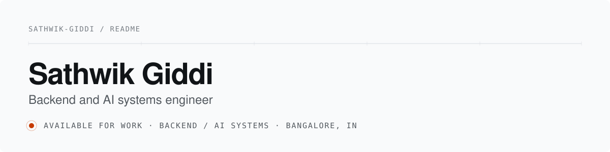

  

I build backend services and the AI systems on top of them. Python and FastAPI for the API layer, Go and TypeScript for services that have to stay up, PostgreSQL and Redis for the data, Docker, Kubernetes and Terraform for shipping it.

Most of my work lives in the failure path: what happens when a dependency is slow, a schema drifts, or a token expires mid-request.

## Now

| | |
| --- | --- |
| **Role** | Software Engineering Intern, Backend at Intellious Technologies, Jun 2026 to present |
| **Building** | A retrieval agent that answers from voice. Speech is the input I have the least patience for, so the refusal path gets built before the happy path. |

## Selected systems

| System | What it is | Stack |
| --- | --- | --- |
| **DeployX** | Multi-tenant deploy platform. Discovers a customer environment, models service and data dependencies, validates compatibility, then emits Terraform, Helm, IAM policies, health checks and smoke tests behind a canary with an automated rollback path. | Python, TypeScript, FastAPI, Kubernetes, Terraform |
| **RemoteOps** | Multi-organization access-control console. Tenant isolation, JWT rotation with token-reuse detection, and audit and penetration-testing harnesses so the security claims are checkable rather than asserted. | JWT, RBAC, Playwright |
| **Cannvue** | AI interview platform. Real-time interview flow over WebSockets and WebRTC, answer evaluation, proctoring, multilingual TTS. Used by 50+ users across 2 institutes (self-reported). | FastAPI, React, Socket.IO, WebRTC, PostgreSQL |
| **StartupVerse** | Distributed startup simulator. A deterministic business rules engine with five AI functions including multi-agent debate and RAG memory, live events over WebSockets, and a deterministic fallback when the AI provider is down. | Go, Python, PostgreSQL, Redis, WebSockets |
| **Legal LLM** | Llama 2-7B fine-tuned with LoRA and QLoRA on legal contracts. PDF extraction and semantic chunking feed structured summaries. 92% ROUGE-L, 500 ms inference on an EC2 g4dn.xlarge (self-reported). | PyTorch, Hugging Face, LoRA, AWS |

Engineering notes on all 13 systems, covering what each one does under failure:
[**/Sathwik-giddi/portfolio**](https://github.com/Sathwik-giddi/portfolio)

## How I work

1. Find work done by hand that repeats every week.
2. Build the smallest version that removes it.
3. Put it in front of users within days.
4. Measure. Keep what moves the number. Delete the rest.

**Write the test that would have caught it.** 22 integration and API suites on the Intellious services exist because regressions in timesheets and payroll are expensive.

**Latency is a feature.** Chunking, indexes and caching are product decisions, not afterthoughts.

**Ship on a cadence.** Weekly sprints at Azmth. Predictable releases beat large reveals.

## Writing

Notes from the failure paths, published on the portfolio site:

- Idempotency keys and the retry storm
- JWT rotation and token reuse detection
- RAG that degrades instead of lying
- Canary deploys and rollback paths
- Multi-tenant RBAC
- Schema drift detection

## Certified

| Certification | Issuer | Issued |
| --- | --- | --- |
| SAP Certified Back-End Developer, ABAP Cloud | SAP | October 2026 |
| Fabric Analytics Engineer Associate | Microsoft | August 2026 |
| Cloud Infrastructure 2025, AI Foundations Associate | Oracle | October 2025 |
| Enterprise Design Thinking Practitioner | IBM SkillsBuild | December 2025 |
| Agentforce Specialist | Salesforce | August 2025 |

## Stack

  
  
  
  
  
  
  
  
  
  
  
  
  
  

## Activity

  
  

  

## Open to

Backend internships, platform roles and applied AI work. If you are building something where correctness and latency both matter, I want to hear about it.

  
  
  
  

  Every number on this profile is measured or self-reported, and labelled as one of the two. Last profile update: <!-- LAST_UPDATED -->2026-10-11<!-- /LAST_UPDATED -->

